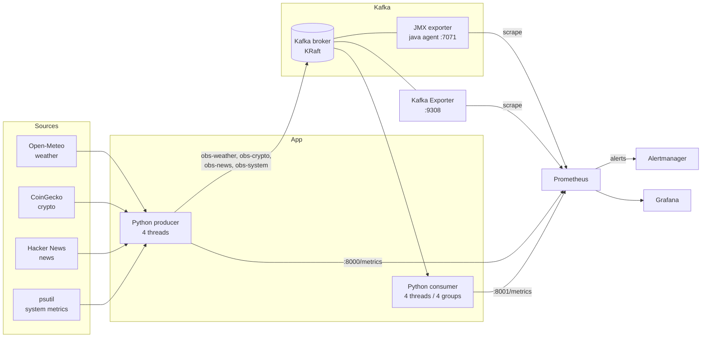

# Kafka Observability Platform

An end-to-end observability stack for Apache Kafka. A 4-stream event pipeline (weather, crypto, news, and system metrics) runs on custom Python producers and consumers. Broker, topic, consumer-lag, and application metrics are collected with **Prometheus**, **Kafka Exporter**, and the **JMX Exporter**, visualized in **Grafana**, and covered by alert rules. The stack runs locally with **Docker Compose** and deploys to **AWS EKS**, with a **Jenkins** pipeline that lints, tests, builds, and scans images with **Trivy** before release.

## Architecture



## What is monitored

| Signal | Source | Where to see it |
|---|---|---|
| Health score (0-100) | Derived from exporter status and total lag | Grafana, top-left gauge |
| Exporter status (Kafka Exporter, JMX Exporter) | Prometheus `up` | Grafana status panels |
| Consumer lag per topic | Kafka Exporter | Grafana, `Consumer lag by topic` |
| Offset growth per topic | Kafka Exporter | Grafana, `Offset growth` |
| Topic ingestion rate (msg/s) | Kafka Exporter | Grafana, `Topic ingestion rate` |
| Broker throughput, replication, controller, JVM heap | JMX Exporter | Grafana, `Broker internals` row |
| Processing time and end-to-end latency | Custom app metrics | Grafana, `Latency` row |
| Active alerts | Prometheus rules | Grafana table, Prometheus `/alerts`, Alertmanager UI |

### Alert rules

Defined in [`monitoring/prometheus/alert_rules.yml`](monitoring/prometheus/alert_rules.yml). Prometheus evaluates every 15 seconds and every rule waits at most 2 minutes (`for: 2m`), so alerts fire within about 2.5 minutes of a problem starting, well inside a 5-minute target.

| Alert | Condition | Severity |
|---|---|---|
| KafkaExporterDown / KafkaBrokerJmxDown | scrape target down for 1m | critical |
| KafkaNoBrokersAvailable | `kafka_brokers < 1` for 1m | critical |
| KafkaActiveControllerCountInvalid | active controllers != 1 for 2m | critical |
| KafkaUnderReplicatedPartitions | under-replicated partitions > 0 for 2m | warning |
| KafkaConsumerLagHigh / Critical | lag > 100 / > 1000 for 2m | warning / critical |
| ConsumerEndToEndLatencyHigh | p95 latency > 30s for 2m | warning |
| ConsumerProcessingErrors / ProducerDeliveryErrors | errors in last 5m | warning |
| ProducerStreamStalled | no messages sent for 2m | warning |

## Repository layout

```
.
├── app/                    # Python producer, consumer, data sources
├── tests/                  # pytest unit tests (no Kafka needed)
├── kafka/                  # Kafka image with the JMX exporter java agent
├── monitoring/
│   ├── prometheus/         # scrape config + alert rules
│   ├── alertmanager/       # routing config
│   └── grafana/            # provisioned datasource + dashboard JSON
├── k8s/                    # Kubernetes manifests for EKS
├── eks/cluster.yaml        # eksctl cluster definition
├── scripts/                # push-images.sh, deploy-eks.sh
├── docker-compose.yml      # local stack
├── Jenkinsfile             # CI/CD pipeline
├── Dockerfile              # app image (non-root)
└── Makefile                # shortcuts
```

## Quick start (Docker Compose)

Requirements: Docker with Compose v2, and about 3 GB of free RAM.

```bash
git clone https://github.com/Dhanush-kumar-143/kafka-observability-platform.git
cd kafka-observability-platform
cp .env.example .env          # optional: set a Grafana password
docker compose up -d --build  # or: make up
docker compose ps             # wait until kafka is "healthy"
```

| Service | URL |
|---|---|
| Grafana | http://localhost:3000 (admin / the password in `.env`, default `admin`) |
| Prometheus | http://localhost:9090 (alerts at `/alerts`) |
| Alertmanager | http://localhost:9093 |
| Producer metrics | http://localhost:8000/metrics |
| Consumer metrics | http://localhost:8001/metrics |
| Kafka Exporter | http://localhost:9308/metrics |
| Broker JMX metrics | http://localhost:7071/metrics |

Open Grafana, then **Dashboards > Kafka > Kafka Observability Platform**. Data appears after about a minute.

No internet access for the demo APIs? Set `SIMULATED_DATA=true` in `.env` and every stream uses generated data. If a live API fails at runtime, the producer falls back to simulated data automatically.

### Demo: trigger a consumer-lag alert

```bash
make lag-demo      # consumer now takes 3s per message
```

Within a couple of minutes, `Consumer lag by topic` climbs, the health score drops, and `KafkaConsumerLagHigh` moves to pending, then firing (see Prometheus `/alerts` or the `Active alerts` table). Restore normal speed with:

```bash
make lag-reset
```

### Stop and clean up

```bash
make down      # stop, keep data
make clean     # stop and delete volumes
```

## Configuration

All settings are environment variables (see [`app/config.py`](app/config.py)).

| Variable | Default | Purpose |
|---|---|---|
| `KAFKA_BOOTSTRAP_SERVERS` | `kafka:9092` | Broker address |
| `SIMULATED_DATA` | `false` | Skip external APIs |
| `WEATHER_INTERVAL_SECONDS` / `CRYPTO_...` / `NEWS_...` / `SYSTEM_...` | 10 / 10 / 20 / 1 | Fetch interval per stream |
| `WEATHER_CITY`, `WEATHER_LATITUDE`, `WEATHER_LONGITUDE` | Mumbai | Weather location |
| `CRYPTO_COINS` | `bitcoin,ethereum,solana` | Coins to track |
| `TOPIC_PARTITIONS` | `3` | Partitions per topic |
| `CONSUMER_DELAY_MS` | `0` | Artificial delay per message (builds lag) |

## Testing

```bash
python -m venv .venv && source .venv/bin/activate   # Windows: .venv\Scripts\activate
pip install -r requirements-dev.txt
flake8 app tests
pytest -q
```

The unit tests need no Kafka: they cover event envelopes, API fallback to simulated data, news de-duplication, and per-stream processing logic.

## CI/CD with Jenkins

The [`Jenkinsfile`](Jenkinsfile) runs these stages:

1. **Lint**: `flake8` and `docker compose config` validation
2. **Unit tests**: `pytest`
3. **Build images**: app image and Kafka+JMX image
4. **Trivy scan**: fails the build on fixable `HIGH` or `CRITICAL` vulnerabilities
5. **Push to ECR** and 6. **Deploy to EKS**: run only when the `PUSH_AND_DEPLOY` parameter is ticked

Jenkins agent needs: Docker, Python 3 with venv, AWS CLI, kubectl, `envsubst` (gettext), and Trivy. Add a Jenkins credential with ID `aws-credentials` (AWS Credentials plugin) and set `ECR_REGISTRY` in the Jenkinsfile.

## Deploy to AWS EKS

Prerequisites: AWS CLI configured, `eksctl`, `kubectl`, Docker, `envsubst`.

```bash
# 1. Create the cluster (costs money while running!)
eksctl create cluster -f eks/cluster.yaml

# 2. Build and push images to ECR
export AWS_REGION=ap-south-1
export ECR_REGISTRY=<aws-account-id>.dkr.ecr.${AWS_REGION}.amazonaws.com
export IMAGE_TAG=v1
./scripts/push-images.sh

# 3. Deploy Kafka, exporters, Prometheus, Alertmanager, Grafana, producer, consumer
./scripts/deploy-eks.sh          # prints the generated Grafana admin password

# 4. Open Grafana
kubectl -n kafka-obs port-forward svc/grafana 3000:3000
# then browse to http://localhost:3000
```

Tear down when finished:

```bash
eksctl delete cluster -f eks/cluster.yaml
```

## Design notes

- **KRaft mode**: Kafka runs without ZooKeeper (single combined broker/controller node for the demo).
- **JMX exporter as a java agent** inside the Kafka image gives broker internals without a sidecar. The compose healthcheck clears `KAFKA_OPTS` so the CLI does not start a second agent on the same port.
- **One consumer group per stream** keeps lag visible per stream and stops one stream's rebalance from pausing the others.
- **At-least-once processing**: offsets are committed after a message is processed.
- **Same Prometheus config everywhere**: Kubernetes Service names match the Compose service names, so one `prometheus.yml` serves both.
- **Containers run as non-root** and images are scanned in CI.

## Limitations

This is a learning and portfolio project, not a hardened production deployment:

- Single broker, replication factor 1, no TLS or SASL authentication.
- Prometheus on Kubernetes uses `emptyDir` storage, so metrics are lost if the pod restarts.
- Alertmanager has no notification receiver configured by default (a Slack example is commented in `alertmanager.yml`).
